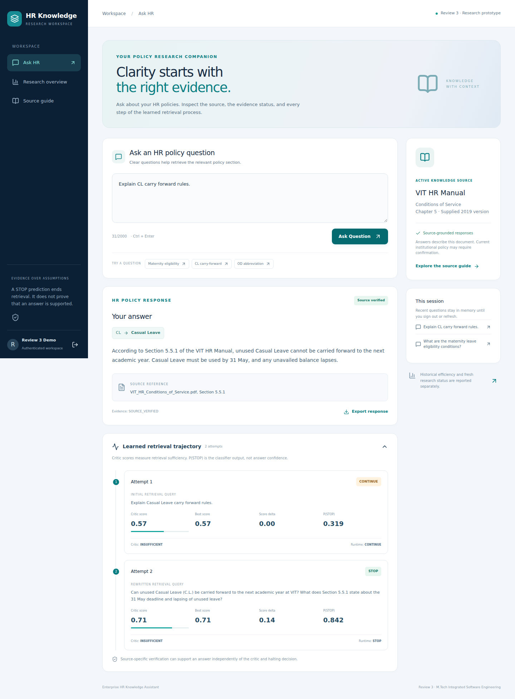
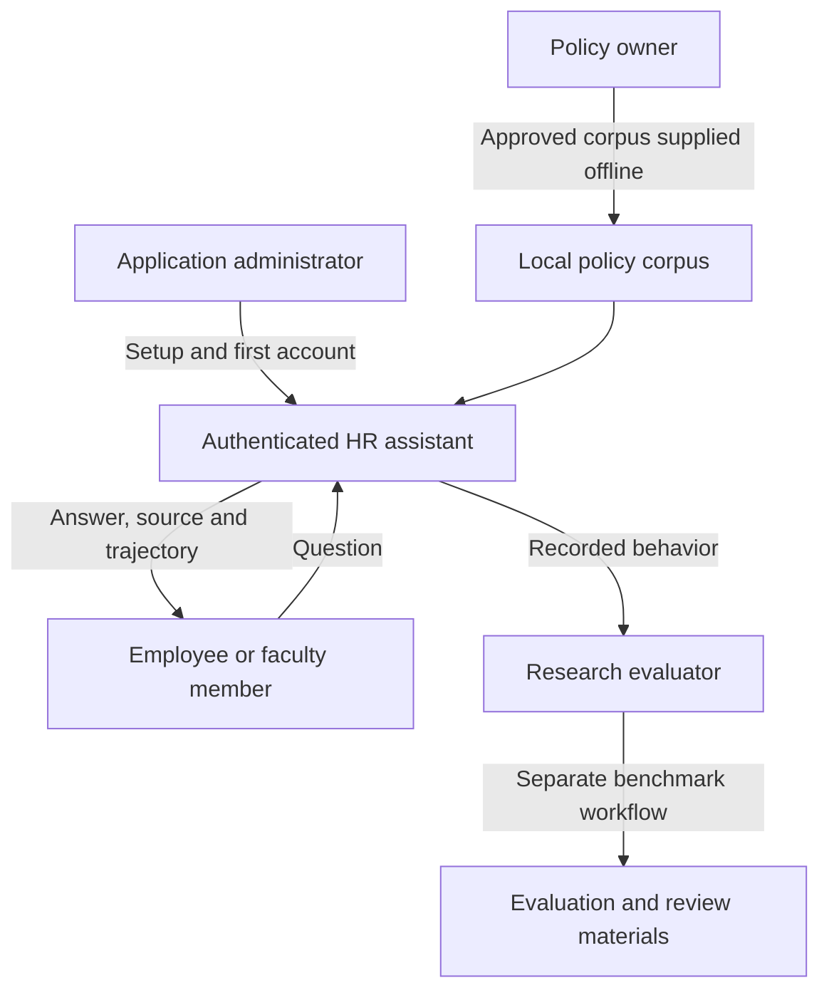
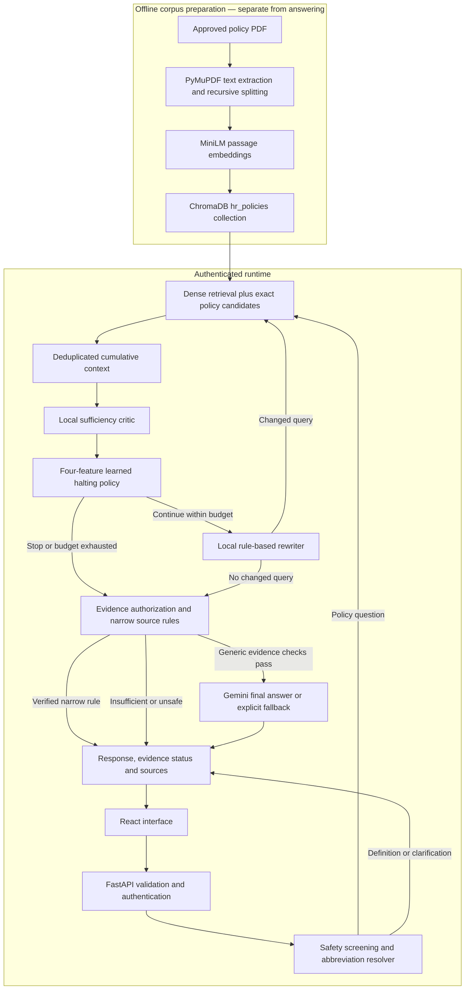
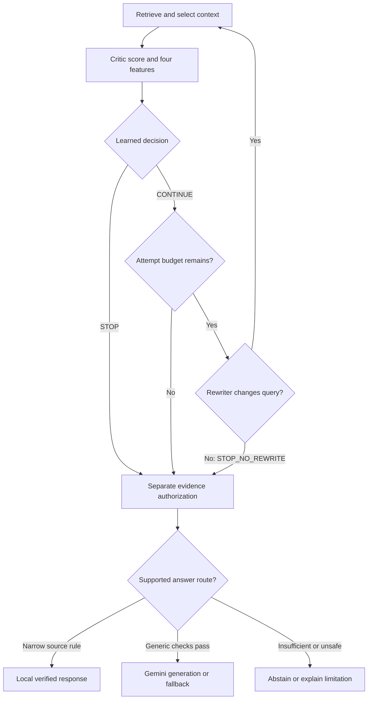
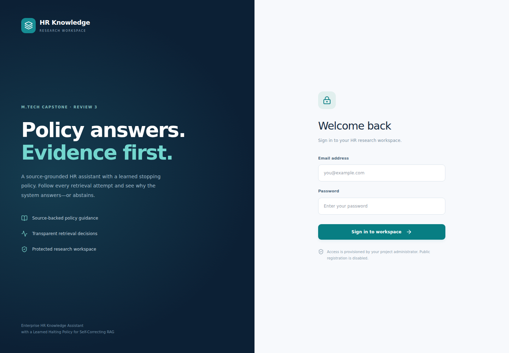
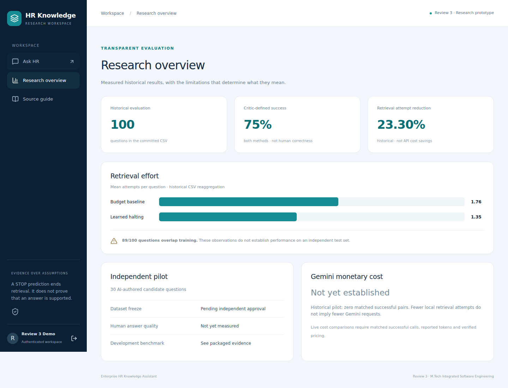
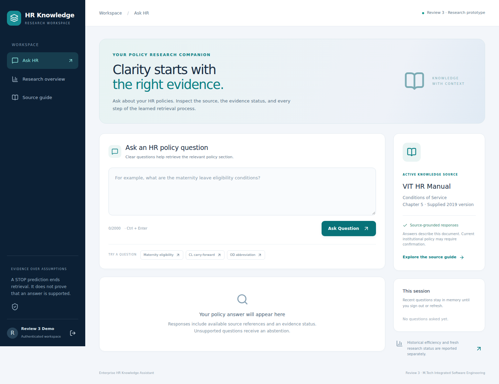
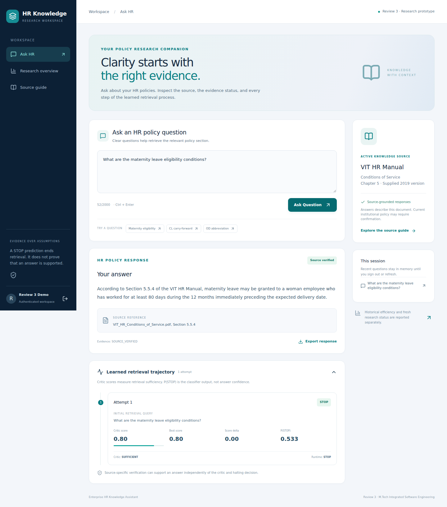
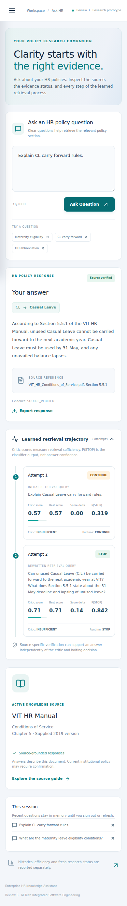

<div align="center">

# Enterprise HR Knowledge Assistant

### Self-Correcting RAG with Machine-Learned Retrieval Halting

**Find the policy. Inspect the evidence. Understand why retrieval stopped.**


**M.Tech Integrated Software Engineering · Academic research prototype · Review 3**

[Overview](#overview) · [Architecture](#architecture) · [Screenshots](#screenshots) · [Installation](#installation) · [Results](#results) · [Research documents](#research-documents)

</div>

> **Project status:** Implemented application with recorded automated and local browser verification. Independent answer-quality evaluation and a defensible Gemini monetary-cost comparison remain incomplete. The public source download requires additional approved runtime artifacts.


*Recorded authenticated Casual Leave demonstration. The source-verified answer and retrieval decisions are separate parts of the response.*

<a id="overview"></a>
## 1. What is this project?

This application helps people ask questions about an HR policy document in ordinary English. Instead of manually searching a long PDF, a user can ask **“Can unused Casual Leave be carried over to the next academic year?”** and inspect the relevant policy reference alongside the response.

It uses **Retrieval-Augmented Generation (RAG)**: first find relevant document passages, then use those passages to support an answer. A local **critic** estimates whether the retrieved text is sufficient. A small machine-learning classifier helps decide whether to **STOP** searching or **CONTINUE** with a rewritten query.

The application also checks evidence before answering. Two narrow policy rules—Casual Leave carry-forward and specified maternity eligibility questions—can produce locally verified responses when their required source text is present. Other supported questions can use Gemini for final answer generation after evidence checks. Unknown abbreviations or inadequate evidence can lead to clarification or abstention.

**A STOP prediction is not proof of answer correctness.** Source references let users check what the supplied document actually says. The prototype describes the supplied VIT HR policy version; it is not a guarantee of current institutional policy or an official HR decision.

## 2. Who uses the application?

| User | Interaction | Scope today |
|---|---|---|
| Employee / faculty member | Asks about supported leave and service-policy topics; reads evidence and sources | Authenticated question-answering interface |
| HR department / policy administrator | Would select and maintain approved organizational documents | Intended organizational responsibility; no document-upload or automatic synchronization dashboard |
| Researcher / evaluator | Inspects trajectories, historical metrics, benchmark outputs and review packets | UI research overview plus separate evaluation scripts |
| Application administrator | Prepares the local environment and provisions the first account | Launcher prompts; no distinct administrator permission role or multi-role management UI |



## 3. Problem and objectives

HR policies contain conditions, limits and exceptions spread across lengthy documents. Manual searching takes time; abbreviations can be unclear; fluent answers without evidence can mislead. Repeating retrieval unnecessarily also consumes local computation.

This project aims to:

- Retrieve relevant policy passages and retain useful evidence across attempts.
- Make query rewrites and stopping decisions visible.
- Learn when another retrieval attempt may be useful.
- Keep retrieval decisions separate from permission to produce an answer.
- Evaluate retrieval effort, answer quality, latency and API usage as different measurements.

These are engineering and research objectives. The available experiments do **not** establish independent generalization, superior answer quality or monetary savings.

## 4. Implemented features

| Feature | What it does → why it matters | Example |
|---|---|---|
| Semantic retrieval | Searches ChromaDB using local embeddings → finds related wording | A natural-language leave question |
| Focused context | Combines dense results with topic/section-marker matches and deduplicates candidates → retains relevant clauses | Casual Leave section 5.5.1 |
| Local critic | Combines semantic similarity and keyword coverage → estimates retrieval sufficiency | `SUFFICIENT` at score ≥ 0.75 |
| Learned halting | Uses a saved Logistic Regression model → decides whether to attempt more retrieval | STOP / CONTINUE and P(STOP) |
| Rule-based rewriting | Reformulates supported question patterns locally → can improve retrieval | A later trajectory row shows the rewritten query |
| Verified abbreviations | Uses a source-linked glossary → avoids inventing expansions | A known abbreviation receives an expansion; unresolved ones request clarification |
| Evidence checks | Gates generation and applies narrow source rules → supports abstention | Missing required maternity evidence cannot trigger the verified eligibility rule |
| Source display | Shows the returned PDF/section reference → supports manual checking | Section 5.5.1 for the verified CL response |
| Authentication | Local password hashing and JWT-protected `/ask` → restricts question requests | Provisioned account signs in |
| Responsive dashboard | React workspace, research overview and source guide → makes demonstrations understandable | Desktop and mobile layouts |
| Transparent trajectory | Shows attempts, queries, scores, decisions and runtime action → exposes retrieval behavior | No-rewrite termination is distinct from classifier STOP |
| Response export | Downloads the current response as JSON → preserves a result for inspection | **Export response** button |

Session question history stays in browser memory until refresh/sign-out. The interface does not provide persistent chat storage, a PDF viewer with automatic clause highlighting, or enterprise document permissions.

<a id="architecture"></a>
## 5. System architecture

The **active application path** is `app.py` → `review3_pipeline.py`, reusing retrieval components from `local_self_correcting_rag.py`. The older loop in the latter file is not the canonical Review 3 route. The independent four-policy benchmark has its own runner under `research/review3/finalization/`.



The ingestion script specifies recursive chunks of 500 characters with 100-character overlap. That is **not a demonstrated section-aware ingestion algorithm**. Runtime section-marker selection is a separate mechanism. Do not run ingestion over the protected research index merely to set up the application.

| Signal | Meaning | What it does not establish |
|---|---|---|
| Retrieval distance / candidate rank | Similarity and heuristic priority used to select passages | Answer correctness |
| Critic score | Weighted local estimate of question–context relevance/coverage | Human-validated correctness or completeness |
| P(STOP) | Classifier probability for the STOP label | Probability that the answer is true |
| `SOURCE_VERIFIED` | A narrow source rule matched required supporting text | Verification of every possible HR question |
| Generated answer with `SUFFICIENT` evidence | Passed implemented evidence checks | Independent human approval |

## 6. Working principle: Casual Leave example

1. Open the local application and sign in using the provisioned account.
2. Enter **“Can unused Casual Leave be carried over to the next academic year?”**
3. FastAPI validates the request and checks authentication.
4. The resolver handles any recognized abbreviation; unknown or ambiguous abbreviations request clarification.
5. Retrieval combines semantic search with relevant policy-marker matches.
6. The critic scores the selected context. The classifier receives four features and predicts STOP or CONTINUE.
7. A changed rewrite can trigger another attempt, within the three-attempt limit. An unchanged rewrite ends the loop.
8. The backend separately checks whether evidence supports answering. The CL carry-forward rule requires the relevant section and supporting restriction/deadline text.
9. When supported, the response explains that unused CL cannot be carried forward and lapses on 31 May according to the supplied policy. Otherwise the application may withhold an answer.
10. The UI displays the answer, source, evidence status and recorded trajectory.



## 7. How the learned halting policy works

A **retrieval attempt** is one pass through search, context selection and scoring. More attempts are useful only if they recover useful evidence. A **Logistic Regression classifier** is a small model that learns a weighted decision boundary from examples; here it predicts one of two labels: `1 = STOP`, `0 = CONTINUE`.

| Feature, in model order | Definition in the active Review 3 pipeline |
|---|---|
| `attempt` | Current attempt number |
| `score` | Current critic score |
| `best_score` | Highest critic score including the current attempt |
| `score_delta` | Current score minus the best score **before** this attempt; zero on attempt 1 |

The saved model returns its predicted class and P(STOP). Runtime follows the predicted class, subject to the attempt limit and no-rewrite exit. The optional `chunk_overlap` argument in the policy wrapper is **not** a fifth model feature.

**Illustration only—not measured model output:**

| Attempt | Current score | Best score | Delta | Hypothetical prediction |
|---:|---:|---:|---:|---|
| 1 | 0.58 | 0.58 | 0.00 | CONTINUE |
| 2 | 0.79 | 0.79 | +0.21 | STOP |

This illustrates feature construction, not a guarantee that the actual classifier makes those predictions. A strict fixed-budget policy executes its full retrieval budget; a learned policy can stop earlier. The historical comparator labelled “fixed” is an early-exit baseline, not the strict three-attempt policy in the newer benchmark.

<details>
<summary><strong>Advanced: training labels, evaluation and research contribution</strong></summary>

Training trajectories contain 113 rows from 89 original questions, with 99 STOP and 14 CONTINUE labels. The recorded label-generation rule uses the immediate next attempt: CONTINUE is assigned when an insufficient state is followed by a sufficient next state; sufficient, exhausted or non-improving-next-step states receive STOP. These are heuristic trajectory labels, not human correctness labels or estimates of the value of all future retrieval.

Grouped splitting and cross-validation keep rows from the same exact original question together. This does not eliminate semantic near-duplicate leakage. Class balancing is used during fitting; the minority class remains small. The diagnostic results and per-class metrics are discussed in [Technical_Report.md](documents/Technical_Report.md).

The research question is whether learned stopping can change retrieval effort while preserving independently assessed answer quality under controlled conditions. Implementing known retrieval, correction and stopping components together is not evidence of novelty. The contribution must be measured through controlled comparisons and ablations; independent evaluation remains pending.

</details>

## 8. Technology stack

| Layer | Verified technology | Contribution |
|---|---|---|
| Interface | React, TypeScript, HTML, CSS, Vite; Tailwind integration and Lucide icons | Typed UI, responsive presentation and production asset build |
| API | Python 3.12, FastAPI, Pydantic | REST endpoints, request validation and structured responses |
| Retrieval | ChromaDB, Sentence Transformers `all-MiniLM-L6-v2` | Local vector search and semantic representations |
| Policy model | scikit-learn Logistic Regression, joblib | Lightweight learned STOP / CONTINUE inference |
| Ingestion utilities | PyMuPDF, LangChain text splitter | Offline PDF extraction and recursive chunking |
| Final generation | Google GenAI SDK / Gemini integration | Generates an answer from permitted evidence when that route is used |
| Accounts | SQLite, pwdlib password hashing, PyJWT | Local accounts and signed, expiring authentication tokens |
| Testing | pytest, FastAPI TestClient; Playwright browser scripts | Behavioral checks and recorded UI verification |
| Evaluation | CSV/JSON manifests, grouped classification diagnostics, four-policy runner | Traceable experiments and review materials |

Dependency presence alone does not imply a feature. For example, this README does not claim implemented multi-role authorization or automatic document synchronization.

<a id="screenshots"></a>
## 9. Application screenshots

These are existing repository screenshots, not generated mockups. Recorded browser checks used authenticated local requests, supplied research artifacts and no Gemini key. They demonstrate narrow local policy paths, not all generated answers.

| Sign in | Research overview |
|---|---|
|  |  |
| Provisioned-account login interface | Historical metrics separated from pending measurements |

<details>
<summary><strong>Open the workspace, policy-response and mobile gallery</strong></summary>


*Question entry, supported examples and source guide.*


*Recorded maternity eligibility response with section reference and retrieval trajectory.*



*Recorded 390-pixel-wide mobile layout. The same response and evidence concepts remain visible.*

</details>

See [UI acceptance report](documents/UI_Acceptance_Report.md) and [recorded response evidence](evidence/ui/real_ui_results.json). The separate `before-static-replay-*` images are documented visual replays, not additional live backend tests.

<a id="installation"></a>
## 10. Windows 11 installation

### Before you begin: source repository versus private runtime package

**The audited `review3-final` source tree does not contain the trained model, protected VIT PDF, ChromaDB index or compiled React `dist` directory. A fresh source download is not sufficient to run the full application.**

Obtain the approved runtime artifacts from the project maintainer or your existing private final package. There is no verified public artifact-download link. Keep them at these paths:

| Required artifact | Location relative to the project root |
|---|---|
| Trusted saved classifier | `application/research/vit_v1/halting_policy_vit_v3.pkl` |
| Approved source PDF | `application/documents/vit/VIT_HR_Conditions_of_Service.pdf` |
| Complete vector index | `application/chroma_db/`, including `chroma.sqlite3` and all index subdirectory files |
| Optional prebuilt React client | `application/frontend/dist/` |

Copy a complete matching artifact set; do not assemble individual database files from different runs. Compare against [protected_assets.json](application/research/review3/finalization/protected_assets.json) using Preflight. Do not change expected hashes to hide a mismatch, retrain the model, or rebuild the index as a setup shortcut. Only load a trusted model file. Policy-document distribution requires the appropriate permission; the software license does not establish those rights.

### Step 1 — Install the prerequisites

- **Python 3.12** with the Windows Python launcher (`py`) from [python.org](https://www.python.org/downloads/windows/).
- **Node.js** from [nodejs.org](https://nodejs.org/en/download) if building the React source. Use a release satisfying the Vite version in the lockfile; check any npm engine warning. A private package with working compiled assets can run without Node.
- **Git for Windows** from [git-scm.com](https://git-scm.com/downloads/win) if using Git rather than downloading a ZIP.
- Internet access for Python dependencies and initial embedding-model downloads. A Gemini key is needed only for live Gemini generation/evaluation, not the two narrow local verified demonstrations.

In PowerShell, verify the tools you installed:

```powershell
py -3.12 --version
node --version
npm.cmd --version
```

The launcher installs dependencies in `application/.venv`, an isolated Python environment for this project. The supplied requirements are pinned; availability and compatibility on your Windows machine must still be checked by Prepare. The published automated evidence is Linux-based.

### Step 2 — Download and locate the project

Open the [review3-final branch](https://github.com/yusufthecoder474/hr-self-correcting-rag/tree/review3-final), select **Code → Download ZIP**, then right-click the downloaded ZIP and choose **Extract All**. Do not run inside the compressed folder.

Open the extracted folder containing `START_REVIEW3.bat`, `RUN_REVIEW3.ps1` and `application`. Right-click empty space and choose **Open in Terminal**, or type `powershell` into File Explorer's address bar.

For the existing local final package, the folder is:

```powershell
Set-Location 'D:\Downloads\HR_RAG_Review3_Final_Complete_Package\HR_RAG_Review3_Final_Complete_Package'
```

Use your actual extracted folder if it differs. Restore the approved artifacts listed above before preparation.

### Step 3 — Prepare once

Double-click `START_REVIEW3.bat`, enter `Prepare`, and wait for installation, frontend build, tests and artifact checks. Alternatively, from PowerShell in the project root:

```powershell
.\RUN_REVIEW3.ps1 -Mode Prepare
```

Prepare uses Python 3.12, installs CPU PyTorch and the pinned requirements, builds React when `npm.cmd` is available, runs the targeted tests and performs Preflight. Without Node it requires an existing `frontend/dist/index.html`.

**If Windows blocks PowerShell scripts, do not globally disable execution policy.** Use your institution's permitted local execution procedure or contact its administrator. Stop at the first failed step and retain the error text, with secrets removed.

### Step 4 — Launch and create the first local account

Reopen the launcher and enter `Launch`, or run:

```powershell
.\RUN_REVIEW3.ps1 -Mode Launch
```

On first launch, enter an email, display name and password of at least eight characters, then repeat the password. Password input may not appear on the terminal. The prompt calls this a local administrator account; it provisions an ordinary authenticated application user, not a separate role.

The launcher creates a local JWT secret and account database under `application/runtime/` and copies the protected retrieval assets for runtime use. Keep that directory private. Public registration is disabled by default.

### Step 5 — Open Chrome

Visit **http://127.0.0.1:8000** and sign in with the account you just created. FastAPI serves the built React frontend; a separate frontend process is not required for this workflow. If compiled assets are absent, the backend has a legacy static fallback, which is not the redesigned React interface.

Keep the terminal open while using the app. Press **Ctrl+C** there to stop the server.

<details>
<summary><strong>Optional: rebuild React or configure live generation</strong></summary>

To rebuild the interface after frontend source changes:

```powershell
Push-Location .\application\frontend
npm.cmd ci
if ($LASTEXITCODE -ne 0) { throw 'Frontend dependency installation failed' }
npm.cmd run build
if ($LASTEXITCODE -ne 0) { throw 'Frontend build failed' }
Pop-Location
```

Restart Launch and refresh Chrome. Do not use Vite preview as a substitute for the authenticated backend.

For Gemini generation, configure `GEMINI_API_KEY` locally using the procedure in [SECURE_SETUP.md](application/research/review3/SECURE_SETUP.md). Never commit it or put it into frontend code. Model/settings and pricing assumptions are recorded in `review3_generation.py` and `research/review3/pricing.json`; verify applicable provider pricing and account tier before live cost experiments. Retrieval, the critic, rewriting and the halting classifier run locally; they do not call Gemini on every attempt.

</details>

### Common setup problems

| Symptom | What to check |
|---|---|
| `py` or Python 3.12 not found | Install the Python 3.12 Windows launcher support, then open a new terminal |
| Prepare cannot build frontend | Install compatible Node, or obtain the approved prebuilt `dist` directory |
| Protected asset mismatch / missing model | Restore a complete untouched approved artifact set; do not edit the expected hashes |
| Database collection missing | Confirm the complete `chroma_db` folder; do not create an empty replacement |
| 503 retrieval unavailable | Check model/index paths and dependency errors in the server terminal |
| Login fails | Use the account created by this package's Launch; an older package may have a different account database |
| Port 8000 already in use | Stop the previous local server with Ctrl+C before launching another |
| Insufficient evidence | This is a valid evidence outcome; rephrase clearly or consult the source rather than bypassing checks |
| Gemini unavailable | Verify local credentials, model access and service availability; fallback is not a successful generated answer |

## 11. Using the application

1. Sign in and choose **Ask HR**.
2. Enter the Casual Leave example or use **Maternity eligibility** / **CL carry-forward**.
3. Click **Ask Question** (or Ctrl+Enter).
4. Read the response and its evidence label before relying on it.
5. Inspect the source filename and any supplied section. A filename alone is not a claim-by-claim citation check.
6. Expand **Learned retrieval trajectory**. Read each query, critic score, P(STOP), classifier decision and runtime action.
7. Open **Research overview** for labelled historical statistics and pending measurements.
8. Use **Export response** to download the current JSON response. Session history is temporary.

| Label | Read it as | Do not read it as |
|---|---|---|
| Source verified (`SOURCE_VERIFIED`) | A specific supported rule matched the source text | Every answer has human approval |
| Verified definition | A glossary expansion is supported | All policy conditions are answered |
| Insufficient evidence | Available evidence does not authorize a reliable response | Proof that the policy itself contains no answer |
| STOP | The classifier predicts retrieval should stop | The answer is correct |
| CONTINUE | The classifier requests another attempt | A guarantee the runtime can continue or improve |
| `STOP_NO_REWRITE` | No changed rewrite was available | A new classifier prediction |

<a id="results"></a>
## 12. Evaluation and results

### Historical evaluation — not an independent test

[Reaggregated metrics](application/static/research_metrics.json) identify [advanced_question_results_v2.csv](application/research/vit_v1/advanced_question_results_v2.csv) as the 100-question source.

| Historical method | Mean retrieval attempts | Critic-defined retrieval success |
|---|---:|---:|
| Existing baseline, labelled “fixed” in historical files | 1.76 | 75% |
| Learned halting | 1.35 | 75% |

The historical retrieval-attempt reduction is **(1.76 − 1.35) / 1.76 × 100 = 23.30%**. It is a descriptive historical comparison. **89 of the 100 evaluation questions overlapped with training questions.** The historical baseline can exit early; it is not equivalent to always making three attempts. Success is critic-defined retrieval sufficiency, not human-rated answer accuracy.

### Fresh development benchmark — known questions only

[Primary development summary](application/research/review3/independent_eval_30/results/development_sequential/summary.json): four known questions × four policies × three repetitions = **48 retrieval-only observations**. Repetitions do not create 48 independent questions.

| Policy | Mean attempts | Final critic success | Mean local retrieval-loop latency |
|---|---:|---:|---:|
| Learned halting | 1.50 | 25% | 123.7 ms |
| Critic-guided | 1.25 | 50% | 100.7 ms |
| Single retrieval | 1.00 | 50% | 75.2 ms |
| Strict fixed budget, three attempts | 3.00 | 0% | 237.4 ms |

These small Linux development measurements do not establish learned-policy superiority. They use the final critic state; the strict budget may continue after useful earlier evidence. Narrow source-rule answers are a separate measurement. Human answer accuracy is `null`; API requests are zero because generation was disabled. Latency above is not live Gemini end-to-end latency.

### Independent evaluation and API cost

| Measurement | Current supported status |
|---|---|
| Candidate questions | 30 AI-authored, source-anchored drafts |
| Overlap screening | 214 historical references; two high-risk candidates and 23 broad-topic overlaps |
| Independent approval / freeze | Not established; approval required |
| Human correctness and completeness | Not established |
| Live matched API-cost reduction | Not established |
| Published preflight | 59 indexed chunks and four model features in the private artifact set |

Fewer local retrieval attempts do **not** automatically reduce Gemini requests or monetary cost. Changed context length can change tokens even with the same request count. The [API cost report](documents/API_Cost_Report.md) preserves this distinction. A header-only fresh cost CSV is not a measured zero-cost result.

## 13. Testing and verification

The checked-in [final test log](evidence/final_tests.txt) records **89 passed, one warning**, with Linux workspace paths. It comprises 80 original Review 3 checks, two root tests and seven benchmark tests. A claim of “89 passed on Windows” requires a separate Windows execution log; this repository evidence does not establish it.

Run the same targeted selection after Prepare:

```powershell
.\RUN_REVIEW3.ps1 -Mode Test
.\RUN_REVIEW3.ps1 -Mode Preflight
```

<details>
<summary><strong>Equivalent direct test command and test scope</strong></summary>

From the project root:

```powershell
Push-Location .\application
.\.venv\Scripts\python.exe -m pytest tests/review3 test_query_rewriter.py test_trajectory_logger.py -q
Pop-Location
```

The tests cover request/authentication controls, evidence/abbreviation behavior, narrow policy rules, trajectory handling and benchmark behavior. Some isolate components with test doubles; passing them does not prove universal factual correctness or live provider reliability. Avoid replacing the targeted command with unrestricted pytest discovery: historical experimental scripts can be collected and require separate artifacts/dependencies.

</details>

The [frontend build log](evidence/frontend_build.txt) records a successful TypeScript/Vite build. [Browser evidence](evidence/ui/real_ui_results.json) records authenticated maternity and CL demonstrations at desktop and mobile sizes without a Gemini key. These are previously recorded checks, not a fresh rerun performed merely to write this README.

## 14. Repository guide

| Path | Purpose |
|---|---|
| `application/` | FastAPI backend, runtime components and source utilities |
| `application/frontend/` | React/TypeScript frontend source and build configuration |
| `application/research/` | Historical experiments, Review 3 audits and reproducible evaluation scripts |
| `application/tests/` | Targeted Review 3 and browser tests |
| `documents/` | Technical report, manuscript, presentation and research protocols |
| `evaluation/` | Candidate workbook, overlap screening and blank human-review materials |
| `evidence/` | Recorded tests, build logs, screenshots and response evidence |
| `backup/` | Historical README/summary and restoration guidance; the private UI rollback ZIP is not tracked in the audited public branch |
| `START_HERE.md` | Final package orientation and completion limits |
| `RUN_REVIEW3.ps1` / `START_REVIEW3.bat` | Consolidated local workflow |

<details>
<summary><strong>Research workflow modes</strong></summary>

- **Development**: rerun the four known development questions under four policies.
- **Screen**: screen candidate questions against historical data.
- **Freeze**: requires genuine reviewer approval and the bound reference/screening files.
- **Frozen**: run approved frozen retrieval evaluation.
- **FrozenAnswers**: explicit live completion pilot after approved frozen retrieval; requires credentials and may incur API usage.
- **Report**: display available result summaries.

Do not fabricate approval fields or tune on frozen-test outputs. The current public/private artifact separation must be resolved before running artifact-dependent modes.

</details>

<a id="research-documents"></a>
## 15. Research documents

- [Technical report](documents/Technical_Report.md) — architecture, evidence and classification diagnostics.
- [Research paper draft](documents/Research_Paper.md) — evidence-bounded manuscript, not an accepted publication.
- [Review 3 presentation](documents/Review_3_Presentation.pptx) — editable demonstration deck.
- [Experiment protocol](documents/Review_3_Experiment_Protocol.md) — controls and independent-review workflow.
- [Candidate review workbook](evaluation/Candidate_Review_Workbook.xlsx) — source drafts and review materials.
- [API-cost report](documents/API_Cost_Report.md) — unavailable measurements and comparison limits.
- [Recorded Claude findings reconciliation](documents/Claude_Findings_Verification.md) — verification scope and actions.
- [README verification report](documents/README_Verification_Report.md) — repository snapshot and documentation checks.

## 16. Limitations and future work

The corpus is restricted to the supplied policy version. The critic and source rules are heuristic; source verification covers narrow question patterns. Pattern-based safety screening is supplemental, not prompt-injection immunity. The prototype has local accounts, not enterprise roles, document-level authorization or a production deployment assurance.

Independent human assessment, semantic-overlap resolution and matched API measurements remain pending. Historical training overlap and the small imbalanced trajectory dataset limit research claims. A changed local index or model can invalidate reproducibility checks.

Next research steps are to obtain independent approvals, freeze the dataset, run controlled four-policy comparisons, collect blind human ratings and measure paired API usage. Separate ablations should isolate acronym resolution, context selection, learned stopping and evidence gating. Section-aware ingestion, broader corpora and production deployment controls are future work unless separately implemented and evaluated.

## 17. Academic and portfolio value

This project demonstrates integration of a Python API, a typed React interface, local semantic retrieval, a learned classifier, authentication, evidence-aware response routing and reproducible research tooling. It also demonstrates an engineering discipline: reporting unsuccessful or incomplete experiments honestly and distinguishing model decisions from answer quality.

For a demonstration, show one source-verified policy answer, inspect its trajectory, explain an insufficient-evidence response, then open the research overview. Be prepared to explain why reducing retrieval attempts is different from reducing API cost.

## 18. Author and license

Maintainer: [@yusufthecoder474](https://github.com/yusufthecoder474).

The repository's [MIT license](application/LICENSE) names **Mohammad Yusuf** as the copyright holder (2026). No supervisor, co-author, publication or institutional endorsement is asserted here. Third-party policy documents and model artifacts may have separate terms; the code license does not establish their redistribution rights.

---

<div align="center">

**Transparent retrieval. Explicit evidence. Measured claims.**

[Back to top](#enterprise-hr-knowledge-assistant)

</div>
